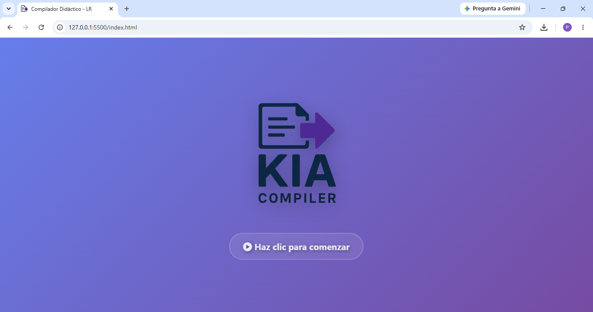
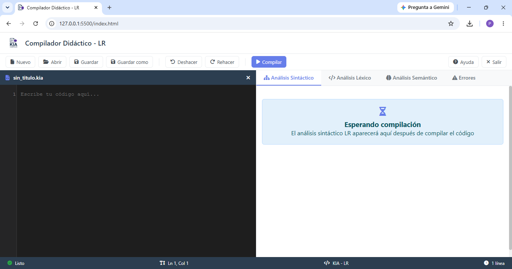
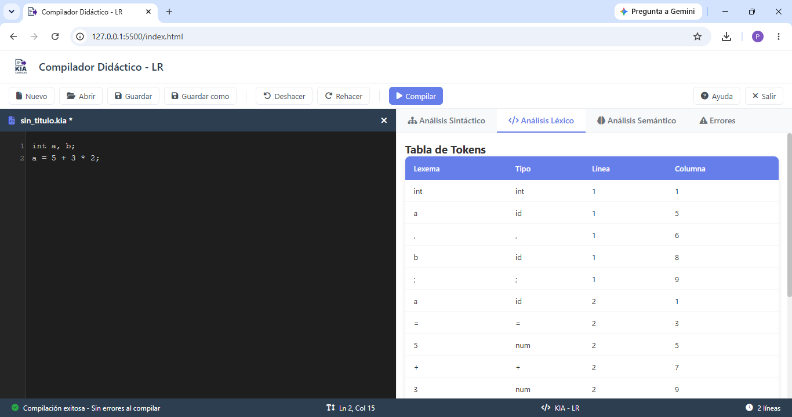
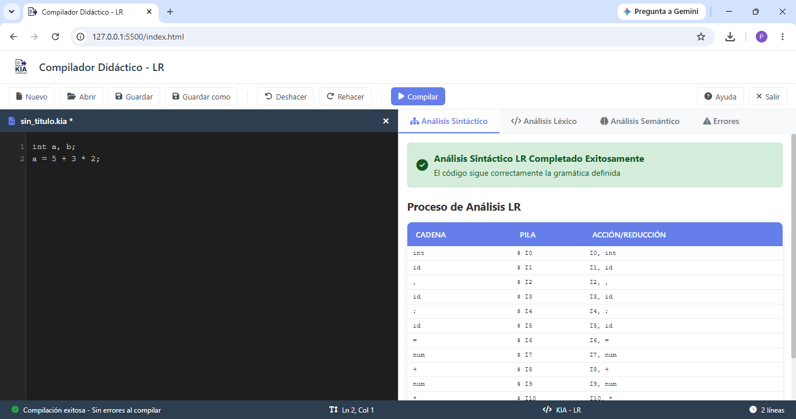
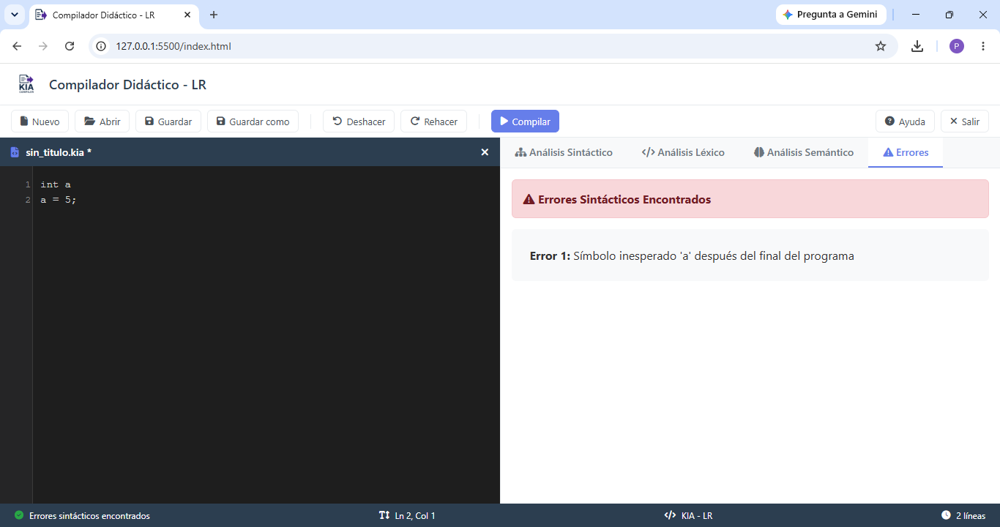

# KIA — Didactic LR Compiler

A didactic compiler that runs directly in the browser. It takes code written in the **KIA** language and shows, step by step, the **lexical analysis**, the **LR syntactic analysis**, the **semantic analysis** (with symbol table and intermediate code), and any errors found.

> **KIA** comes from the initials of the team members: **K**atia, **I**samar, and **A**ngel.

Team project developed at Instituto Tecnológico de Jiquilpan.

---

## English

### Team

| Member |
| ------ |
| Katia Paola Victoria Escalera |
| Isamar Chávez Díaz |
| Ángel de Jesús Canela Figueroa |

### Features

- **Built-in editor** with line numbering, open/save `.kia` files, undo, and redo.
- **Lexical analysis:** token table generated from the source code.
- **LR syntactic analysis:** parser with a combined ACTION/GOTO table and step-by-step trace of the process.
- **Semantic analysis:** symbol table, intermediate code, semantic trace, warnings, and errors.
- **Error report** for lexical, syntactic, and semantic errors in a dedicated tab.
- **No installation required:** it's a static web application (HTML + CSS + JavaScript).

### Screenshots

**Start screen**


**Main interface**


**Lexical analysis**


**LR syntactic analysis**


**Error report**


### The KIA language

| Element | Detail |
| ------- | ------ |
| Data types | `int`, `float`, `char` |
| Declaration | `int a, b;` |
| Assignment | `a = 5 + 3 * 2;` |
| Expressions | `+`, `-`, `*`, `/` and parentheses |
| Conditions | `<`, `>`, `<=`, `>=`, `==`, `!=` |
| Loop | `for (i = 0; i < 10; i++) ...` (also with `--`) |
| Selection | `switch (x) { case 1: ... break; default: ... }` |
| Input / output | `leer('mensaje', x);` and `escribir('mensaje', x);` |

**Examples**

```
int a, b;
a = 5 + 3 * 2;
```

```
int i;
for (i = 0; i < 10; i++) i = i + 1;
```

### How to run it

No installation or server required.

1. Clone the repository:
   ```bash
   git clone https://github.com/KPVE2004/compilador-kia.git
   cd compilador-kia
   ```
2. Open `index.html` in your browser (double-click, or use the *Live Server* extension in VS Code).
3. Write or open a `.kia` program and press **Compile**.

> The interface icons are loaded from a CDN (Font Awesome), so an internet connection is required to see them.

### Project structure

```
├── index.html          # Main interface
├── estilos.css         # Application styles
├── img/                # Logos
└── js/
    ├── lexico.js       # Lexical analyzer
    ├── lr-parser.js    # LR syntactic analyzer (ACTION/GOTO table)
    ├── semantico.js    # Semantic analyzer, symbol table, and intermediate code
    ├── compilador.js   # Orchestrates the compilation process and displays results
    └── app.js          # Editor and UI logic
```

### Tech stack

HTML5 · CSS3 · JavaScript (ES6) · Font Awesome

### Academic context

Compilers course project — Instituto Tecnológico de Jiquilpan.

---

## Español

Compilador didáctico que corre directamente en el navegador. Recibe código escrito en el lenguaje **KIA** y muestra, paso a paso, el **análisis léxico**, el **análisis sintáctico LR**, el **análisis semántico** (con tabla de símbolos y código intermedio) y los errores encontrados.

> **KIA** nace de las iniciales de los integrantes del equipo: **K**atia, **I**samar y **A**ngel.

Proyecto desarrollado en equipo en el Instituto Tecnológico de Jiquilpan.

### Equipo

| Integrante |
| ---------- |
| Katia Paola Victoria Escalera |
| Isamar Chávez Díaz |
| Ángel de Jesús Canela Figueroa |

### Características

- **Editor integrado** con numeración de líneas, abrir/guardar archivos `.kia`, deshacer y rehacer.
- **Análisis léxico:** tabla de tokens generada a partir del código fuente.
- **Análisis sintáctico LR:** analizador con tabla combinada ACTION/GOTO y traza paso a paso del proceso.
- **Análisis semántico:** tabla de símbolos, código intermedio, traza semántica, advertencias y errores.
- **Reporte de errores** léxicos, sintácticos y semánticos en una pestaña dedicada.
- **Sin instalación:** es una aplicación web estática (HTML + CSS + JavaScript).

### Capturas

**Pantalla de inicio**


**Interfaz principal**


**Análisis léxico**


**Análisis sintáctico LR**


**Reporte de errores**


### El lenguaje KIA

| Elemento | Detalle |
| -------- | ------- |
| Tipos de dato | `int`, `float`, `char` |
| Declaración | `int a, b;` |
| Asignación | `a = 5 + 3 * 2;` |
| Expresiones | `+`, `-`, `*`, `/` y paréntesis |
| Condiciones | `<`, `>`, `<=`, `>=`, `==`, `!=` |
| Ciclo | `for (i = 0; i < 10; i++) ...` (también con `--`) |
| Selección | `switch (x) { case 1: ... break; default: ... }` |
| Entrada / salida | `leer('mensaje', x);` y `escribir('mensaje', x);` |

**Ejemplos**

```
int a, b;
a = 5 + 3 * 2;
```

```
int i;
for (i = 0; i < 10; i++) i = i + 1;
```

### Cómo ejecutarlo

No requiere instalación ni servidor.

1. Clona el repositorio:
   ```bash
   git clone https://github.com/KPVE2004/compilador-kia.git
   cd compilador-kia
   ```
2. Abre `index.html` en tu navegador (doble clic, o con la extensión *Live Server* de VS Code).
3. Escribe o abre un programa `.kia` y presiona **Compilar**.

> Los íconos de la interfaz se cargan desde un CDN (Font Awesome), por lo que se necesita conexión a internet para verlos.

### Estructura del proyecto

```
├── index.html          # Interfaz principal
├── estilos.css         # Estilos de la aplicación
├── img/                # Logotipos
└── js/
    ├── lexico.js       # Analizador léxico
    ├── lr-parser.js    # Analizador sintáctico LR (tabla ACTION/GOTO)
    ├── semantico.js    # Analizador semántico, tabla de símbolos y código intermedio
    ├── compilador.js   # Orquesta el proceso de compilación y muestra resultados
    └── app.js          # Lógica del editor y de la interfaz
```

### Tecnologías

HTML5 · CSS3 · JavaScript (ES6) · Font Awesome

### Contexto académico

Proyecto de compiladores — Instituto Tecnológico de Jiquilpan.

---

## Author · Autora

**Katia Paola Victoria Escalera**

[GitHub](https://github.com/KPVE2004) · [LinkedIn](https://www.linkedin.com/in/katia-paola-victoria-escalera-148688442/) · [Email](mailto:kp_victoria08@hotmail.com)
